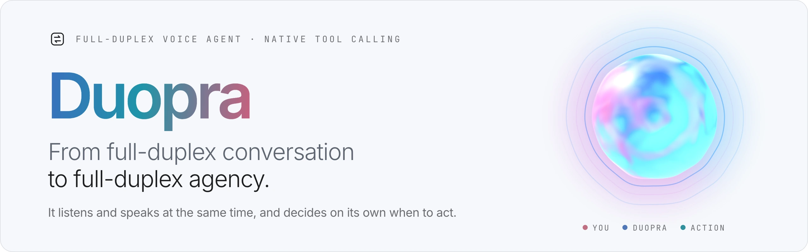
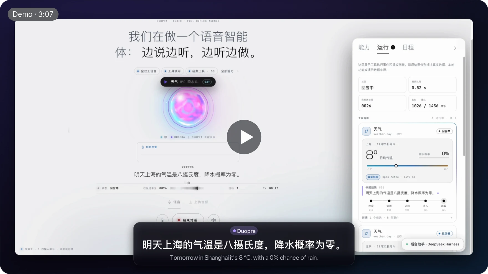
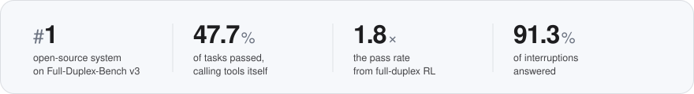
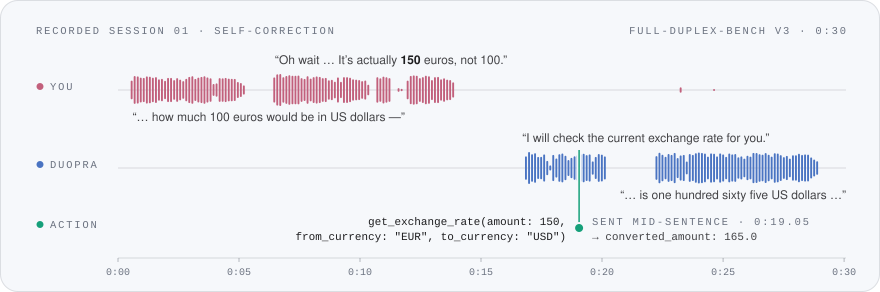

<div align="center">

<picture>
  <source media="(prefers-color-scheme: dark)" srcset="docs/assets/readme/banner-en-dark.webp">
  
</picture>

Chiyu Chen<sup>1,2*</sup> · Pengzhou Cheng<sup>3*</sup> · Yuezhao Ma<sup>1</sup> · Xiaocheng Li<sup>1</sup> · Can Liu<sup>1</sup> · Haonan Hu<sup>2</sup> · Yao Yao<sup>1</sup> · Yifei Yang<sup>1</sup><br>
Yijie Lu<sup>1</sup> · Taolei Wang<sup>1</sup> · Yansi Li<sup>1</sup> · Muhuan Wu<sup>4</sup> · Chenglu Sun<sup>2†</sup> · Gongshen Liu<sup>1‡</sup> · Zhuosheng Zhang<sup>1‡</sup>

<sub><sup>1</sup>Shanghai Jiao Tong University &nbsp;·&nbsp; <sup>2</sup>Tencent &nbsp;·&nbsp; <sup>3</sup>Shanghai University &nbsp;·&nbsp; <sup>4</sup>University of Bristol</sub><br>
<sub><sup>*</sup>Equal contribution &nbsp;·&nbsp; <sup>†</sup>Project lead &nbsp;·&nbsp; <sup>‡</sup>Corresponding authors</sub>

<br>

[](https://cychen2003.github.io/duopra/)
[](https://huggingface.co/Chechen123/Duopra)
[](https://arxiv.org/abs/2611.25773)
[](#citation)
[](NOTICE)

**English** &nbsp;·&nbsp; [简体中文](README_zh.md)

[Overview](#overview) · [Demo](#demo) · [How it works](#how-it-works) · [Results](#results) · [Quick start](#quick-start) · [Tools](#tools) · [Citation](#citation)

</div>

<br>

<a id="video"></a>

<a href="https://cychen2003.github.io/duopra/assets/video/duopra-demo.mp4"></a>

<p align="center"><sub>▶&nbsp; <a href="https://cychen2003.github.io/duopra/assets/video/duopra-demo.mp4"><b>Play the demo</b></a> &nbsp;·&nbsp; 3:06, in Chinese with English at the end &nbsp;·&nbsp; also on the <a href="https://cychen2003.github.io/duopra/#film">project page</a></sub></p>

<picture>
  <source media="(prefers-color-scheme: dark)" srcset="docs/assets/readme/stats-dark.svg">
  
</picture>

## News

- **2026-11-20** &nbsp; The preprint is out on [arXiv:2611.25773](https://arxiv.org/abs/2611.25773).
- **2026-11-16** &nbsp; The [demo video](#video) is out: three minutes in the Duopra app — a tool call while it talks, the backend model called as one more tool, and interruptions it keeps up with.
- **2026-11-15** &nbsp; The [project page](https://cychen2003.github.io/duopra/) is live, with both recorded sessions replayed second by second, the full results and every number. Code and [model weights](https://huggingface.co/Chechen123/Duopra) are out.

<a id="overview"></a>

## Overview

Full-duplex models already know when to listen and when to speak. **Duopra also knows when to act**: it calls tools itself, mid-sentence, through actions that are never voiced.

Every second, a single policy reads the new audio and any tool results that have come back, and emits three things at once: whether to listen or to speak, the words to voice, and an action that is never spoken. A backend model, if you connect one, is simply one more tool.

<table>
<tr>
<td width="33%" valign="top">

**Listens while it speaks**

Every second it decides whether to listen or to speak. It takes the turn when you finish, holds back in a mid-sentence pause and gives way when you cut in.

</td>
<td width="33%" valign="top">

**Acts mid-sentence, silently**

Tool calls go out on a private channel while Duopra is still talking. The call itself is never spoken — only its result is.

</td>
<td width="33%" valign="top">

**Keeps up with corrections**

Change a value halfway through a request and only the final value reaches the tool: `amount: 150`. The abandoned 100 never does.

</td>
</tr>
<tr>
<td width="33%" valign="top">

**Several steps in one request**

Two changes asked for in one hesitant breath become two calls, and each is reported only after its result comes back.

</td>
<td width="33%" valign="top">

**Calls a backend like any tool**

Connect a backend model and it becomes one more tool, `query(task)`. The hand-off happens mid-conversation, with no pause you can hear.

</td>
<td width="33%" valign="top">

**Bring your own tools**

A tool is a JSON schema — a name, a description and its parameters — supplied at run time. Your calendar, your database, your home: describe it, and Duopra can call it. [How to add one →](#add-your-own-tools)

</td>
</tr>
</table>

<a id="demo"></a>

## Demo

<picture>
  <source media="(prefers-color-scheme: dark)" srcset="docs/assets/readme/session-dark.svg">
  
</picture>

**Session 01 · a correction.** The user asks for 100 euros in US dollars, then corrects it to 150 before finishing. Duopra waits for the turn to end, starts answering and — while it is still speaking — sends `get_exchange_rate(amount: 150, from_currency: "EUR", to_currency: "USD")`. It reports 165 once the result is back. The abandoned 100 never reaches the tool.

**Session 02 · two steps.** Two autopay changes asked for in one hesitant breath become two `modify_autopay` calls; the second goes out while Duopra is still reading the result of the first.

<p align="center"><a href="https://cychen2003.github.io/duopra/#demo"><b>▶&nbsp; Listen to both sessions, second by second, on the project page</b></a></p>

> [!NOTE]
> Two selected sessions from the evaluation, not a success rate. User audio is from [Full-Duplex-Bench v3](https://github.com/DanielLin94144/Full-Duplex-Bench/tree/main/v3); the tools are benchmark mocks.

<a id="how-it-works"></a>

## How it works

**One policy decides what to say and what to do.** Every second, Duopra reads the new audio and any tool results, then emits

$$y_t = (m_t,\ w_t,\ a_t)$$

- $m_t$ — **turn state**: listen or speak
- $w_t$ — **words**, voiced by the talker
- $a_t$ — **action**: a tool call, never voiced

One causal policy, conditioned on the audio so far, the observations injected so far and its own past outputs. Conversation and tool use are decided together, not handed between components.

- **The backend is one more tool.** A background agent is exposed as `query(task)`, whose argument is a self-contained description of the user's task. Calling a tool directly or delegating is the same kind of decision, made by the same policy — there is no external dispatcher.
- **Results land on unit boundaries.** A runtime executes each call asynchronously and injects the result at the first one-second boundary after it returns. The model keeps listening and speaking while it waits, and reports a value only once it has arrived.

<p align="center">
  
</p>

<sub><b>Figure 1.</b> Frontend responsibility in an evolving FDB v3 request (<code>ecommerce_19</code>; schematic). Execution can be offloaded, but initiating a faithful request remains a frontend responsibility. The user corrects both the product (laptop to tablet) and the quantity (two to one); <code>add_to_cart</code> depends on the product ID returned by <code>search_products</code>. (a) When domain schemas are available only to the backend, the frontend may need successive hand-offs to convey the evolving request, making it harder to preserve corrections and tool dependencies. (b) With schemas visible, Duopra can issue the corrected domain-tool calls directly without a hand-off, while <code>query(task)</code> remains available. Crossed-out values and curved arrows denote superseded requests. Table 16(a) of the paper reports an observed delegated success on this request.</sub>

### Trained in three stages

One stage for each problem: the form of an action, the decision to act, and a voice that drifts when the thinker changes.

<table>
<tr><th width="24%" align="left">Stage</th><th align="left">What it trains</th><th width="27%" align="left">Outcome</th></tr>
<tr>
<td valign="top"><b>1 · Protocol SFT</b><br><sub>the form of an action</sub></td>
<td valign="top">Supervised fine-tuning of the thinker on synthetic sessions that demonstrate the protocol: call tools by schema, wait for the result before reporting it, ask only for missing values.</td>
<td valign="top">Pass@1 <b>26.0%</b> — calls are well formed, but 55% of sessions still end without one.</td>
</tr>
<tr>
<td valign="top"><b>2 · Full-duplex RL</b><br><sub>the decision to act</sub></td>
<td valign="top">Dr. GRPO on a thinker LoRA, eight rollouts per task, in a sandbox that plays the same scripted user to every rollout. Time-anchored deadlines and outcome tiers reward calls that are timely, complete and grounded.</td>
<td valign="top">Pass@1 26.0 → <b>47.7%</b> — sessions without a call fall from 55% to 19%.</td>
</tr>
<tr>
<td valign="top"><b>3 · Projector-only repair</b><br><sub>a voice that stays intelligible</sub></td>
<td valign="top">Post-training shifts the thinker's hidden states, which condition the talker. Only the projector between them is retrained, on cached features; text, control tokens and calls are untouched.</td>
<td valign="top">Chinese character error rate 6.01 → <b>2.58%</b> with the thinker held fixed; English WER 9.74 → 7.66% (221-utterance projector-selection set).</td>
</tr>
</table>

<details>
<summary><b>Figure 2 · the three training stages</b></summary>

<p align="center">
  
</p>

<sub><b>Figure 2.</b> Duopra's three training stages on Realtime-Venus-Audio (<i>h<sub>j</sub></i>: thinker hidden state at spoken-token position <i>j</i>; <i>P</i><sub><i>ϕ</i><sub>0</sub></sub>, <i>P</i><sub><i>ϕ</i></sub>: base and Stage-3 projectors; <i>c<sub>j</sub></i>: talker conditioning). Stage 1 trains the thinker on unit-level sessions and yields Duopra-SFT. Stage 2 trains a thinker LoRA with Dr. GRPO in the sandbox; Stage 2a yields Duopra-RL1 and Stage 2b yields Duopra-RL. Stage 3 freezes the Duopra-RL thinker and trains only its projector, producing the final Duopra model.</sub>

</details>

<a id="results"></a>

## Results

**Pass@1 on Full-Duplex-Bench v3: 49.3% with a backend, 47.7% calling tools itself.** A session passes only when every executed call matches the gold call: right tool, every argument, no extra call. Published results are shown next to Duopra as reference points, not as a common-protocol ranking.

<picture>
  <source media="(prefers-color-scheme: dark)" srcset="docs/assets/readme/ranking-dark.svg">
  
</picture>

<sub>Left, commercial systems as reported; right, open-source systems and Duopra; one scale for both. Full-Duplex-Bench v3: 100 real, disfluent English recordings and 12 simulated APIs. Duopra runs in our streaming pipeline — three seeds, 300 sessions per configuration, judged by Qwen3.8-27B; ± is the standard deviation across seeds. Hatched bars are published results, measured with each source's own evaluation setup and judge (mostly GPT-4o) — reference points, not a common-protocol ranking: MOSS-Live reports a tool-call success rate, DuplexAgent-RSI is measured on VoiceChat with exact-string argument matching, and Realtime-Venus-Audio offline has the tool definitions in the prompt. * Commercial system.</sub>

<details>
<summary><b>Every metric for the systems in the chart</b></summary>

<br>

| System | Tool | Arg. | Resp. | Pass@1 |
| :--- | ---: | ---: | ---: | ---: |
| ***Commercial systems\*, as reported*** | | | | |
| GPT-Realtime | 87.6 | 68.0 | 79.2 | 60.0 |
| Gemini Live 3.1 | 81.7 | 58.8 | 71.8 | 54.0 |
| MOSS-Live | n/a | n/a | n/a | 51.0 |
| Gemini Live 2.5 | 78.6 | 59.3 | 55.4 | 49.0 |
| Cascaded | 80.3 | 56.2 | 60.0 | 45.0 |
| Grok | 79.7 | 54.2 | 61.7 | 43.0 |
| Ultravox v0.7 | 79.4 | 51.3 | 51.0 | 41.0 |
| ***Open-source systems, as reported*** | | | | |
| Hu et al., Qwen3-235B backend | 71.7 | 55.2 | 67.0 | 48.0 |
| DuplexAgent-RSI | 97.4 | 57.0 | n/a | 47.0 |
| Realtime-Venus-Audio, offline | 82.0 | 52.2 | n/a | 42.0 |
| Gander, GPT-5.6 | 75.9 | 50.3 | 49.0 | 40.0 |
| NemotronLabs VoiceChat | 82.5 | 42.2 | n/a | 33.0 |
| ***Duopra, our streaming pipeline*** | | | | |
| Duopra, calling tools itself | 76.7 | 56.2 | 66.3 | 47.7 ± 3.5 |
| Duopra, Qwen3-8B backend | **81.8** | **57.0** | **70.6** | 44.7 ± 5.7 |
| Duopra, DeepSeek backend | 71.8 | 55.0 | 69.0 | **49.3** ± 3.5 |

<sub>Tool: tool-name F1, which involves no judge (Hu et al. report tool-selection accuracy). Arg.: argument accuracy. Resp.: response quality. n/a: not reported. Bold: best among Duopra's configurations. DuplexAgent-RSI reaches 49.0 on Qwen-Realtime. Calling tools itself is the paper's Direct setting; a named backend is its Backend setting, in which only <code>query(task)</code> is visible. Further open-source systems that we ran in our streaming pipeline are in the paper's Table 1.</sub>

</details>

### Training cuts failures to act

The outcome of each of the 300 sessions, Duopra models calling tools themselves.

| Run | Passed | Wrong argument | Missing call | Extra call | No call |
| :--- | ---: | ---: | ---: | ---: | ---: |
| Duopra-SFT · after Stage 1 | 78 | 17 | 38 | 1 | 166 |
| Duopra-RL1 · after Stage 2a | 80 | 17 | 72 | 0 | 131 |
| **Duopra** · final model | **143** | 58 | 40 | 3 | **56** |

Multi-call requests become solvable: Duopra passes **28 of 102** sessions that need two or three calls, against 2 after SFT. The remaining headroom is in arguments — wrong arguments (19.3% of sessions) are now as common as sessions without a call (18.7%).

### Learning to act, while taking turns better

| Metric | Duopra |
| :--- | ---: |
| Takes the turn after the user finishes ↑ <sub>FDB v1.0 · base model 59.1</sub> | 75.6 |
| Takes the turn during a mid-sentence pause ↓ <sub>FDB v1.0 · base model 18.1</sub> | 5.4 |
| Responds after an interruption ↑ <sub>FDB v1.0 · base model 79.5</sub> | 91.3 |
| Takes the turn at all ↑ <sub>FDB v3, calling tools itself</sub> | 93.0 |
| VoiceBench, mean of nine categories ↑ | 55.9 |
| Factual-answer latency ↓ <sub>domain tools and backend both visible, Qwen3-8B</sub> | 10.42 s |

<sub>Three seeds, in our streaming pipeline; the base model is Realtime-Venus-Audio, which Duopra is built on. Pass@1 is read from the call log rather than the transcript; judged metrics use Qwen3.8-27B, tool-name F1 involves no judge. Factual-answer latency is measured until the factual answer, including runtime and tool execution.</sub>

<a id="quick-start"></a>

## Quick start

### 1. See the interface (CPU)

Python 3.10–3.12.

```bash
python -m venv .venv
.venv/bin/python -m pip install .
.venv/bin/python backend/preview.py --port 23479
```

Open <http://localhost:23479>.

### 2. Run the voice service (GPU)

Linux x86_64 with Conda, an NVIDIA GPU with BF16 support, a driver compatible with CUDA 12.8 and the merged Duopra model.

```bash
pip install -U huggingface_hub
hf download Chechen123/Duopra --local-dir weights/duopra      # the merged model

export DUPLEX_MODEL_DIR=$PWD/weights/duopra
export DUPLEX_GPU_ID=0
python scripts/inventory-model.py --model "$DUPLEX_MODEL_DIR" --output private/model-inventory.json
bash scripts/start.sh --check                                  # runtime and model, without starting
bash scripts/start.sh
```

Open <http://localhost:23479>, allow the microphone and start talking — or upload an audio file. On a remote server: `ssh -N -L 23479:127.0.0.1:23479 user@server`.

### 3. Connect a backend model (optional)

<a id="harness"></a>

```bash
python -m pip install --upgrade --target "${DUPLEX_HARNESS_DEPS:-$CONDA_PREFIX/harness-deps}" \
  -r backend/harness/requirements.txt
```

In the app, open **后台助手 / Background assistant**, enter the base URL, model name and API key — DeepSeek is preset, and OpenAI-compatible endpoints work too — save, and run a manual test. Duopra now sees the backend as one more tool, `query(task)`. Calendar and tasks live in the personal workspace. The container image already includes these dependencies.

<a id="tools"></a>

## Tools

The app ships **68 tools in seven domains**. Each is a JSON schema — name, description, parameters, returns — in [`backend/tools/registry.json`](backend/tools/registry.json), and the interface labels where every result comes from. You can [add your own](#add-your-own-tools).

| Domain | Tools | Live data | Local workspace | Sandbox fixture |
| :--- | ---: | ---: | ---: | ---: |
| Personal | 17 | – | 10 | 7 |
| Information | 11 | 5 | – | 6 |
| Travel | 8 | 2 | – | 6 |
| Daily life | 8 | – | – | 8 |
| Culture | 8 | – | – | 8 |
| Environment | 8 | – | – | 8 |
| Facilities | 8 | – | – | 8 |
| **All** | **68** | **7** | **10** | **51** |

- **Live data** — weather, daylight, time zones, reference exchange rates, stock quotes, market indices and currency trends, from public sources.
- **Local workspace** — calendar and tasks in SQLite on your machine; the model can use them only after you allow personal tools for the session.
- **Sandbox fixture** — fixed demonstration results, marked as such in the interface: they check the call, not the world.

<details>
<summary><b>One entry of the registry</b></summary>

```json
{
  "name": "weather.day",
  "description": "查询指定城市某天的气温与降水",
  "read_only": true,
  "parameters": {
    "type": "object",
    "properties": { "city": { "type": "string" }, "date": { "type": "string" } },
    "required": ["city", "date"],
    "additionalProperties": false
  },
  "returns": {
    "type": "object",
    "properties": { "temperature_c": { "type": "integer" }, "rain_probability": { "type": "number" } },
    "required": ["temperature_c", "rain_probability"]
  }
}
```

</details>

<a id="add-your-own-tools"></a>

### Add your own tools

Beyond the 68, any tool you describe is one Duopra can find and call — in conversation, and from the backend model too. A tool is one JSON file in [`backend/tools/custom/`](backend/tools/custom/) (or the directory named by `DUPLEX_CUSTOM_TOOLS`): the registry's schema format, plus the endpoint that does the work.

**1 · Describe it** in `backend/tools/custom/home.lights.json`:

```json
{
  "name": "home.lights",
  "description": "Turn the lights in one room of the home on or off",
  "parameters": {
    "type": "object",
    "properties": {
      "room": { "type": "string", "description": "The room, such as kitchen or bedroom" },
      "on": { "type": "boolean" }
    },
    "required": ["room", "on"],
    "additionalProperties": false
  },
  "returns": {
    "type": "object",
    "properties": { "room": { "type": "string" }, "on": { "type": "boolean" } },
    "required": ["room", "on"]
  },
  "endpoint": "http://127.0.0.1:8765/lights",
  "read_only": false
}
```

**2 · Serve it.** Duopra sends each call's arguments to the endpoint as one JSON object in a `POST` request — `{"room": "kitchen", "on": true}` — and the endpoint replies with one JSON object that matches `returns`. Any language will do; [`example_endpoint.py`](backend/tools/custom/example_endpoint.py) is one in thirty lines of the Python standard library.

**3 · Restart Duopra.** The tool is listed as *Custom*. Ask for it, and Duopra finds its schema and calls it mid-conversation, like any other tool.

- A tool with `"read_only": false` changes something, so it runs only after you allow personal tools for the session.
- Without an `endpoint`, an `example.result` answers as a marked fixture — a way to try a schema before the service exists.
- Definitions are checked when the service starts: a reused name or a schema keyword the validator cannot enforce is refused, with the file named. Every result is checked against `returns`.
- A container image includes the directory as it was when the image was built; point endpoints at an address the container can reach. All fields: [`backend/tools/custom/README.md`](backend/tools/custom/README.md).

<a id="deployment"></a>

## Deployment

With the NVIDIA Container Toolkit on the host and the model inventory from the quick start:

```bash
python scripts/create-access.py --output private/access.json
cp deploy/nvidia/env.example .env.nvidia
# fill in the domain, device, model directory, model inventory and access file
bash scripts/deploy.sh
```

The script validates the Compose configuration, builds the image and starts the service, with the model mounted read-only, persistent storage and an HTTPS entry point. Devices and image settings: [`deploy/nvidia/env.example`](deploy/nvidia/env.example).

<a id="validation"></a>

## Validation

Verified on an NVIDIA A800: real voice in and out, browser capture and playback, session reconnection, and persistence of calendar and tasks. The CPU regression tests, the frontend checks, the harness's local tool loop and the Compose configuration check pass. Building and running the Docker image and external harness APIs are still to be verified.

```bash
python -m pip install '.[dev]'
python -m unittest discover -s tests -v
node scripts/check-frontend.mjs
# with the service running: streaming input and output, reconnection and RTF on a speech WAV
python scripts/accept-local.py --audio sample.wav --transport stream
```

<a id="code-map"></a>

## Repository layout

```text
duopra/
├── frontend/static/     # voice UI, tool cards, local fonts
├── backend/
│   ├── web/             # HTTP, WebSocket, sessions and access
│   ├── runtime/         # CUDA model loading, duplex inference, audio protocol
│   ├── tools/           # tool registry, executor, calendar and tasks
│   │   └── custom/      # your own tools: a JSON schema and an endpoint each
│   └── harness/         # background worker and its tools
├── deploy/              # NVIDIA Dockerfile and configuration example
├── scripts/             # start, deploy, model inventory, acceptance
├── tests/               # CPU tests: protocol, voice sessions, tools, deployment
└── docs/                # the project page (GitHub Pages) and the figures of this README
```

<a id="citation"></a>

## Citation

<details>
<summary><b>Abstract</b></summary>

Full-duplex interaction models exhibit strong conversational agency, enabling natural, low-latency turn-taking, backchannels, and interruptions. However, completing tasks further requires task agency: timely tool invocation and argument revision following user corrections. Frontend–backend agents separate initiation from execution: the frontend decides whether and what to request, while the backend determines how. Execution can be offloaded, but unsent requests cannot be executed, and incomplete ones can misdirect the backend. On Full-Duplex-Bench v3 (FDB v3), most failures of Realtime-Venus-Audio + Harness in our streaming pipeline occur before a domain tool executes. We introduce **Duopra**, a full-duplex interaction model that learns task execution alongside conversational control. Duopra treats the backend as a tool, accepting a self-contained natural-language request. Direct calls and backend delegation share an action interface and requirements for faithful initiation and correct execution. Its three-stage training combines protocol SFT, full-duplex RL rewarding timely and complete execution, and projector-only repair of talker conditioning after thinker updates. With the same backend, Pass@1 rises from 4.7% to 44.7%; Duopra achieves 47.7% calling tools directly (26.0% after SFT) and 49.3% with a DeepSeek backend. It improves three FDB v1.0 takeover rates over the base model. These results show that task agency can coexist with key conversational agency.

</details>

```bibtex
@misc{duopra2026,
  title  = {Duopra: From Full-Duplex Conversation to Full-Duplex Agency},
  author = {Chen, Chiyu and Cheng, Pengzhou and Ma, Yuezhao and Li, Xiaocheng
            and Liu, Can and Hu, Haonan and Yao, Yao and Yang, Yifei
            and Lu, Yijie and Wang, Taolei and Li, Yansi and Wu, Muhuan
            and Sun, Chenglu and Liu, Gongshen and Zhang, Zhuosheng},
  year   = {2026},
  eprint = {2611.25773},
  archivePrefix = {arXiv},
  primaryClass  = {cs.AI},
  url    = {https://arxiv.org/abs/2611.25773}
}
```

<a id="license"></a>

## License, privacy and security

Licences and attributions for each component are listed in [NOTICE](NOTICE); no blanket open-source licence is asserted for inherited application code, external model code, model weights or vendor runtimes. Models, access credentials and personal data stay in local directories or deployment volumes, and the background assistant sends delegated tasks only to the service you configure — see [SECURITY.md](SECURITY.md).

<br>

<div align="center">

<sub><b>Duopra</b> · Listen. Speak. Act.</sub><br>
<sub><a href="https://cychen2003.github.io/duopra/">Project page</a> · <a href="README_zh.md">简体中文</a> · <a href="#top">Back to top</a></sub>

</div>
