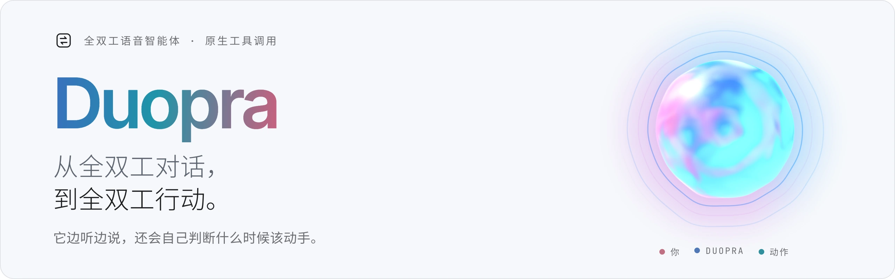
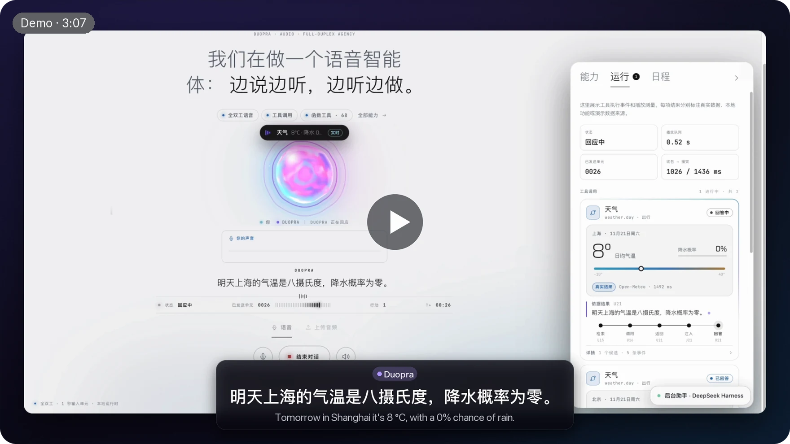
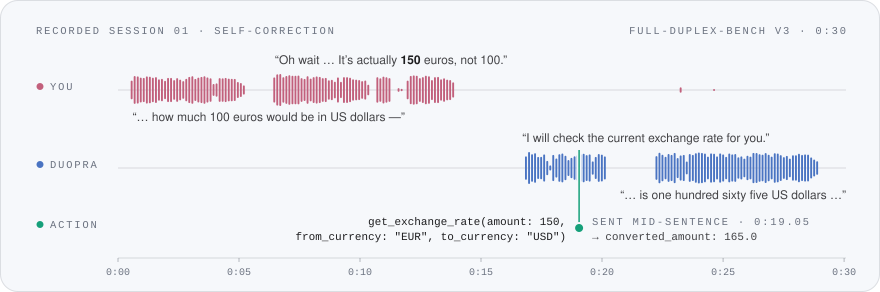
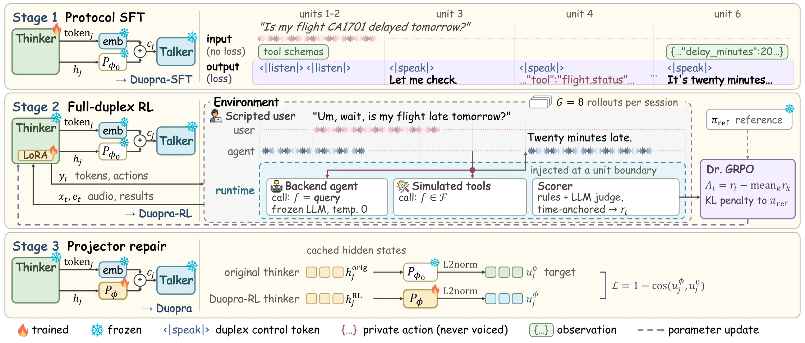
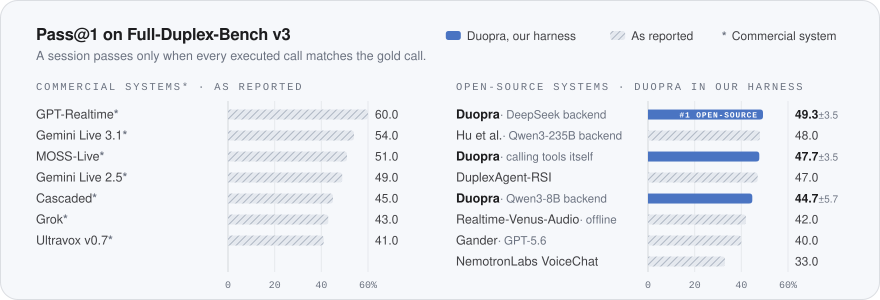

<div align="center">

<picture>
  <source media="(prefers-color-scheme: dark)" srcset="docs/assets/readme/banner-zh-dark.webp">
  
</picture>

Chiyu Chen<sup>1,2*</sup> · Pengzhou Cheng<sup>3*</sup> · Yuezhao Ma<sup>1</sup> · Xiaocheng Li<sup>1</sup> · Can Liu<sup>1</sup> · Haonan Hu<sup>2</sup> · Yao Yao<sup>1</sup> · Yifei Yang<sup>1</sup><br>
Yijie Lu<sup>1</sup> · Taolei Wang<sup>1</sup> · Yansi Li<sup>1</sup> · Muhuan Wu<sup>4</sup> · Chenglu Sun<sup>2†</sup> · Gongshen Liu<sup>1‡</sup> · Zhuosheng Zhang<sup>1‡</sup>

<sub><sup>1</sup>上海交通大学 &nbsp;·&nbsp; <sup>2</sup>腾讯 &nbsp;·&nbsp; <sup>3</sup>上海大学 &nbsp;·&nbsp; <sup>4</sup>布里斯托大学</sub><br>
<sub><sup>*</sup>同等贡献 &nbsp;·&nbsp; <sup>†</sup>项目负责人 &nbsp;·&nbsp; <sup>‡</sup>通讯作者</sub>

<br>

[](https://cychen2003.github.io/duopra/zh/)
[](https://huggingface.co/Chechen123/Duopra)
[](https://arxiv.org/abs/2611.25773)
[](#citation)
[](NOTICE)

[English](README.md) &nbsp;·&nbsp; **简体中文**

[概览](#overview) · [演示](#demo) · [工作方式](#how-it-works) · [实测结果](#results) · [快速开始](#quick-start) · [工具](#tools) · [引用](#citation)

</div>

<br>

<a id="video"></a>

<a href="https://cychen2003.github.io/duopra/assets/video/duopra-demo.mp4"></a>

<p align="center"><sub>▶&nbsp; <a href="https://cychen2003.github.io/duopra/assets/video/duopra-demo.mp4"><b>播放演示视频</b></a> &nbsp;·&nbsp; 3:06，中文，结尾为英文 &nbsp;·&nbsp; 也可以在<a href="https://cychen2003.github.io/duopra/zh/#film">项目主页</a>观看</sub></p>

<picture>
  <source media="(prefers-color-scheme: dark)" srcset="docs/assets/readme/stats-dark.svg">
  
</picture>

## 动态

- **2026-11-20** &nbsp; 预印本已在 [arXiv:2611.25773](https://arxiv.org/abs/2611.25773) 公开。
- **2026-11-16** &nbsp; 发布[演示视频](#video)：在 Duopra 应用中录制的三分钟会话——边说话边调用工具、把后台模型当作又一个工具来调用，以及被打断时怎样接上。
- **2026-11-15** &nbsp; [项目主页](https://cychen2003.github.io/duopra/zh/)上线：两段真实会话的逐秒回放、完整结果和全部数字。代码与[模型权重](https://huggingface.co/Chechen123/Duopra)已经公开。

<a id="overview"></a>

## 概览

全双工模型已经知道什么时候听、什么时候说。**Duopra 还知道什么时候动手**：它在话说到一半时自己调用工具，这些动作从不出声。

每一秒，同一个策略读入新的音频和已返回的工具结果，同时输出三样东西：这一秒是听还是说、要念出的文字，以及一个从不出声的动作。接上后台模型的话，它也只是又一个工具。

<table>
<tr>
<td width="33%" valign="top">

**边听边说**

每一秒，Duopra 都在决定这一秒是听还是说。你说完它接话，你句中停顿它不抢，你插话它就让。

</td>
<td width="33%" valign="top">

**说着话就动手**

工具调用走一条私有通道，在 Duopra 还在说话时就发出。调用本身从不被念出来，念出来的只有结果。

</td>
<td width="33%" valign="top">

**跟得上改口**

请求说到一半改了数值，进入工具的只有最后那个值：`amount: 150`。被放弃的 100 不会。

</td>
</tr>
<tr>
<td width="33%" valign="top">

**一句话里的多步任务**

一口气说出的两项修改，变成两次调用；每一项都等结果返回之后才念出。

</td>
<td width="33%" valign="top">

**后台模型，像工具一样调用**

接上一个后台模型，它就成了又一个工具 `query(task)`。Duopra 把事情交给后台，和调用任何工具一样：对话不停，也听不到任何交接。

</td>
<td width="33%" valign="top">

**工具由你来定**

一个工具就是一份 JSON schema：名字、描述和参数，在运行时提供。写下你自己的工具——日程、数据库、家里的设备——Duopra 就能调用它。[怎么添加 →](#add-your-own-tools)

</td>
</tr>
</table>

<a id="demo"></a>

## 演示

<picture>
  <source media="(prefers-color-scheme: dark)" srcset="docs/assets/readme/session-dark.svg">
  
</picture>

**会话 01 · 中途改口。** 用户要把 100 欧元换成美元，话没说完就改成了 150。Duopra 等这一轮说完才开口，并在还在说话时发出 `get_exchange_rate(amount: 150, from_currency: "EUR", to_currency: "USD")`；结果回来后报出 165 美元。被放弃的 100 没有进入工具。

**会话 02 · 两步任务。** 一口气说出的两项自动扣款修改，变成两次 `modify_autopay` 调用；第二次是在 Duopra 念第一条结果的同时发出的。

<p align="center"><a href="https://cychen2003.github.io/duopra/zh/#demo"><b>▶&nbsp; 在项目主页逐秒收听这两段会话</b></a></p>

> [!NOTE]
> 这是从评测中挑选出来的两段会话，不代表成功率。用户音频来自 [Full-Duplex-Bench v3](https://github.com/DanielLin94144/Full-Duplex-Bench/tree/main/v3)，工具都是基准里的模拟接口。

<a id="how-it-works"></a>

## 工作方式

**说什么、做什么，由同一个策略决定。** 每一秒，Duopra 读入新的音频和已返回的工具结果，同时输出

$$y_t = (m_t,\ w_t,\ a_t)$$

- $m_t$ —— **话轮状态**：听还是说
- $w_t$ —— **文字**：由 talker 念出
- $a_t$ —— **动作**：工具调用，从不出声

这是一个因果策略，条件是到目前为止的音频、已注入的观测和它自己之前的输出。对话与工具调用一起决定，不在组件之间来回传递。

- **后台也只是一个工具。** 后台 agent 以 `query(task)` 的形式出现，参数是对用户任务的完整描述。直接调用还是委派，是同一个策略做出的同一类决定——没有外部调度器。
- **结果落在单元边界上。** 运行时异步执行每次调用，并在结果返回后的第一个 1 秒边界注入上下文。等待期间模型照常听、照常说，结果到了才报出数值。

<p align="center">
  
</p>

<sub><b>图 1.</b> 面对 FDB v3 中一条不断变化的请求，前台要承担的责任（<code>ecommerce_19</code>；示意图）。执行可以交给后台，但发起一条忠实的请求仍是前台的责任。用户既改了商品（从笔记本电脑改成平板），也改了数量（从两件改成一件）；<code>add_to_cart</code> 依赖 <code>search_products</code> 返回的商品 ID。(a) 领域工具的 schema 只在后台时，前台可能要连续多次交接，才能把不断变化的请求转达过去，改口和工具之间的依赖也就更难保住。(b) schema 可见时，Duopra 可以不经交接、直接发出改正后的领域工具调用，同时 <code>query(task)</code> 依然可用。划掉的值和弧形箭头表示被取代的请求。论文表 16(a) 记录了这条请求一次实际的委派成功。</sub>

### 分三个阶段训练

每个阶段解决一个问题：动作的格式、要不要动手，以及 thinker 一变就会跑偏的声音。

<table>
<tr><th width="22%" align="left">阶段</th><th align="left">训练什么</th><th width="28%" align="left">结果</th></tr>
<tr>
<td valign="top"><b>1 · 协议 SFT</b><br><sub>学会动作的格式</sub></td>
<td valign="top">在合成会话上对 thinker 做监督微调，示范完整的协议：按 schema 调用工具，结果返回前不播报，只追问缺失的值。</td>
<td valign="top">Pass@1 <b>26.0%</b>——调用格式正确，但仍有 55% 的会话一次也没调用。</td>
</tr>
<tr>
<td valign="top"><b>2 · 全双工强化学习</b><br><sub>学会何时动手</sub></td>
<td valign="top">在 thinker 的 LoRA 上做 Dr. GRPO，每个任务 8 个 rollout；沙盒给每个 rollout 播放同一个脚本化用户。时间锚定的截止与结果分级，奖励及时、完整、有依据的调用。</td>
<td valign="top">Pass@1 26.0 → <b>47.7%</b>——没有调用的会话从 55% 降到 19%。</td>
</tr>
<tr>
<td valign="top"><b>3 · 只修 projector</b><br><sub>让声音保持清晰</sub></td>
<td valign="top">后训练会改变 thinker 的隐藏状态，而这些状态决定 talker 怎么发音。只在缓存特征上重训两者之间的 projector；文字、控制 token 和调用都不受影响。</td>
<td valign="top">thinker 不变、只换 projector：中文字错误率 6.01 → <b>2.58%</b>，英文 WER 9.74 → 7.66%（221 条 projector 选择集）。</td>
</tr>
</table>

<details>
<summary><b>图 2 · 三个训练阶段</b></summary>

<p align="center">
  
</p>

<sub><b>图 2.</b> Duopra 在 Realtime-Venus-Audio 上的三个训练阶段（<i>h<sub>j</sub></i>：要念出的第 <i>j</i> 个 token 处的 thinker 隐藏状态；<i>P</i><sub><i>ϕ</i><sub>0</sub></sub>、<i>P</i><sub><i>ϕ</i></sub>：基座 projector 与 Stage 3 的 projector；<i>c<sub>j</sub></i>：talker 的条件输入）。Stage 1 在单元级会话上训练 thinker，得到 Duopra-SFT。Stage 2 在沙盒中用 Dr. GRPO 训练 thinker 的 LoRA：Stage 2a 得到 Duopra-RL1，Stage 2b 得到 Duopra-RL。Stage 3 冻结 Duopra-RL 的 thinker，只训练它的 projector，得到最终的 Duopra 模型。</sub>

</details>

<a id="results"></a>

## 实测结果

**Full-Duplex-Bench v3 上的 Pass@1：接后台时 49.3%，自己调用工具时 47.7%。** 一次会话里实际执行的调用与金标完全一致——工具正确、参数全对、没有多余调用——才算通过。图中已发表的结果与 Duopra 并列，仅作参照，并非同一协议下的排名。

<picture>
  <source media="(prefers-color-scheme: dark)" srcset="docs/assets/readme/ranking-dark.svg">
  
</picture>

<sub>左栏为商业系统（文献报告值），右栏为开源系统与 Duopra，两栏同一刻度。Full-Duplex-Bench v3：100 条真实、不流利的英文录音，12 个模拟 API。Duopra 由我们的流式评测流程跑出——3 个种子，每种配置 300 个会话，judge 为 Qwen3.8-27B；± 为种子间的标准差。斜线条为已发表的结果，用的是各自来源的评测设置和 judge（多为 GPT-4o），仅作参照，并非同一协议下的排名：MOSS-Live 报告的是工具调用成功率，DuplexAgent-RSI 基于 VoiceChat、参数按字符串精确匹配，Realtime-Venus-Audio 离线评测时工具定义写在提示词里。* 为商业系统。</sub>

<details>
<summary><b>图中各系统的全部指标</b></summary>

<br>

| 系统 | 工具 | 参数 | 回复 | Pass@1 |
| :--- | ---: | ---: | ---: | ---: |
| ***商业系统\*，文献报告值*** | | | | |
| GPT-Realtime | 87.6 | 68.0 | 79.2 | 60.0 |
| Gemini Live 3.1 | 81.7 | 58.8 | 71.8 | 54.0 |
| MOSS-Live | n/a | n/a | n/a | 51.0 |
| Gemini Live 2.5 | 78.6 | 59.3 | 55.4 | 49.0 |
| Cascaded | 80.3 | 56.2 | 60.0 | 45.0 |
| Grok | 79.7 | 54.2 | 61.7 | 43.0 |
| Ultravox v0.7 | 79.4 | 51.3 | 51.0 | 41.0 |
| ***开源系统，文献报告值*** | | | | |
| Hu et al.，Qwen3-235B 后台 | 71.7 | 55.2 | 67.0 | 48.0 |
| DuplexAgent-RSI | 97.4 | 57.0 | n/a | 47.0 |
| Realtime-Venus-Audio，离线 | 82.0 | 52.2 | n/a | 42.0 |
| Gander，GPT-5.6 | 75.9 | 50.3 | 49.0 | 40.0 |
| NemotronLabs VoiceChat | 82.5 | 42.2 | n/a | 33.0 |
| ***Duopra，我们的流式评测流程*** | | | | |
| Duopra，自己调用工具 | 76.7 | 56.2 | 66.3 | 47.7 ± 3.5 |
| Duopra，Qwen3-8B 后台 | **81.8** | **57.0** | **70.6** | 44.7 ± 5.7 |
| Duopra，DeepSeek 后台 | 71.8 | 55.0 | 69.0 | **49.3** ± 3.5 |

<sub>工具：工具名 F1，不经过 judge（Hu et al. 报告的是工具选择准确率）。参数：参数准确率。回复：回复质量。n/a：未报告。加粗：Duopra 各配置中最好。DuplexAgent-RSI 在 Qwen-Realtime 上为 49.0。“自己调用工具”即论文中的 Direct 设置；标出后台模型的为 Backend 设置，此时只看得到 <code>query(task)</code>。我们在自己的流式评测流程中跑过的其他开源系统见论文表 1。</sub>

</details>

### 训练大幅减少了「不动手」

300 个会话各自的结局，Duopra 各阶段均为自己调用工具。

| 运行 | 通过 | 参数错误 | 漏调用 | 多调用 | 没有调用 |
| :--- | ---: | ---: | ---: | ---: | ---: |
| Duopra-SFT · Stage 1 之后 | 78 | 17 | 38 | 1 | 166 |
| Duopra-RL1 · Stage 2a 之后 | 80 | 17 | 72 | 0 | 131 |
| **Duopra** · 最终模型 | **143** | 58 | 40 | 3 | **56** |

多步请求变得可解：在需要两到三次调用的 102 个会话里，Duopra 通过 **28 个**，SFT 之后只有 2 个。剩下的提升空间在参数上——参数错误（占全部会话 19.3%）已经和没有调用（18.7%）一样多。

### 学会动手，话轮转换也更好了

| 指标 | Duopra |
| :--- | ---: |
| 用户说完后接话 ↑ <sub>FDB v1.0 · 基座模型 59.1</sub> | 75.6 |
| 用户句中停顿时抢话 ↓ <sub>FDB v1.0 · 基座模型 18.1</sub> | 5.4 |
| 被打断后作出回应 ↑ <sub>FDB v1.0 · 基座模型 79.5</sub> | 91.3 |
| 接话率 ↑ <sub>FDB v3，自己调用工具</sub> | 93.0 |
| VoiceBench 九类均值 ↑ | 55.9 |
| 给出事实答案的延迟 ↓ <sub>领域工具与后台同时可见，Qwen3-8B 后台</sub> | 10.42 s |

<sub>3 个种子，在我们的流式评测流程中测得；基座模型为 Duopra 所基于的 Realtime-Venus-Audio。Pass@1 只看调用记录，不看转写；需要判分的指标由 Qwen3.8-27B 作 judge，工具名 F1 不经过 judge。给出事实答案的延迟测到说出事实答案为止，包含运行时和工具执行的时间。</sub>

<a id="quick-start"></a>

## 快速开始

### 1. 先看界面（CPU）

Python 3.10–3.12。

```bash
python -m venv .venv
.venv/bin/python -m pip install .
.venv/bin/python backend/preview.py --port 23479
```

打开 <http://localhost:23479>。

### 2. 启动语音服务（GPU）

Linux x86_64 + Conda，支持 BF16 的 NVIDIA GPU，兼容 CUDA 12.8 的驱动，以及 Duopra 合并模型。

```bash
pip install -U huggingface_hub
hf download Chechen123/Duopra --local-dir weights/duopra      # 合并模型

export DUPLEX_MODEL_DIR=$PWD/weights/duopra
export DUPLEX_GPU_ID=0
python scripts/inventory-model.py --model "$DUPLEX_MODEL_DIR" --output private/model-inventory.json
bash scripts/start.sh --check                                  # 只检查运行时和模型，不启动
bash scripts/start.sh
```

打开 <http://localhost:23479>，授权麦克风就可以开始对话，也可以上传音频文件。服务在远程机器上时：`ssh -N -L 23479:127.0.0.1:23479 user@server`。

### 3. 接上后台模型（可选）

<a id="harness"></a>

```bash
python -m pip install --upgrade --target "${DUPLEX_HARNESS_DEPS:-$CONDA_PREFIX/harness-deps}" \
  -r backend/harness/requirements.txt
```

在页面上打开 **后台助手 / Background assistant**，填写 Base URL、模型名和 API Key（默认是 DeepSeek，也支持 OpenAI 兼容接口），保存后点「手动测试」。之后 Duopra 就把后台当作又一个工具 `query(task)`。日程和待办在「个人工作区」里管理。容器镜像已包含这组依赖。

<a id="tools"></a>

## 工具

应用内置 **7 个领域、68 项工具**。每项工具都是一份 JSON schema（名字、描述、参数、返回值），见 [`backend/tools/registry.json`](backend/tools/registry.json)；界面会标明每条结果的来源。你也可以[加入自己的工具](#add-your-own-tools)。

| 领域 | 工具数 | 真实数据 | 本地工作区 | 演示夹具 |
| :--- | ---: | ---: | ---: | ---: |
| 个人 | 17 | – | 10 | 7 |
| 信息 | 11 | 5 | – | 6 |
| 出行 | 8 | 2 | – | 6 |
| 生活 | 8 | – | – | 8 |
| 文化 | 8 | – | – | 8 |
| 环境 | 8 | – | – | 8 |
| 设施 | 8 | – | – | 8 |
| **合计** | **68** | **7** | **10** | **51** |

- **真实数据**：天气、日照、时区、参考汇率、股票行情、市场指数和汇率走势，来自公开数据源。
- **本地工作区**：日程与待办，存在本机的 SQLite 里；只有你在本次会话里授权个人工具后，模型才能使用。
- **演示夹具**：固定的演示结果，界面上会明确标注——它们检验的是调用本身，不代表真实世界。

<details>
<summary><b>注册表里的一项工具</b></summary>

```json
{
  "name": "weather.day",
  "description": "查询指定城市某天的气温与降水",
  "read_only": true,
  "parameters": {
    "type": "object",
    "properties": { "city": { "type": "string" }, "date": { "type": "string" } },
    "required": ["city", "date"],
    "additionalProperties": false
  },
  "returns": {
    "type": "object",
    "properties": { "temperature_c": { "type": "integer" }, "rain_probability": { "type": "number" } },
    "required": ["temperature_c", "rain_probability"]
  }
}
```

</details>

<a id="add-your-own-tools"></a>

### 加入你自己的工具

68 项之外，你描述的任何工具，Duopra 都能找到并调用——对话中能，接上的后台模型也能。一个工具就是 [`backend/tools/custom/`](backend/tools/custom/)（或 `DUPLEX_CUSTOM_TOOLS` 指定的目录）里的一个 JSON 文件：注册表同样的 schema 格式，再加上真正干活的 endpoint。

**1 · 描述它**，写进 `backend/tools/custom/home.lights.json`：

```json
{
  "name": "home.lights",
  "description": "Turn the lights in one room of the home on or off",
  "parameters": {
    "type": "object",
    "properties": {
      "room": { "type": "string", "description": "The room, such as kitchen or bedroom" },
      "on": { "type": "boolean" }
    },
    "required": ["room", "on"],
    "additionalProperties": false
  },
  "returns": {
    "type": "object",
    "properties": { "room": { "type": "string" }, "on": { "type": "boolean" } },
    "required": ["room", "on"]
  },
  "endpoint": "http://127.0.0.1:8765/lights",
  "read_only": false
}
```

**2 · 实现它。** 每次调用会把参数作为一个 JSON 对象 `POST` 给 endpoint——例如 `{"room": "kitchen", "on": true}`——endpoint 返回一个符合 `returns` 的 JSON 对象。用什么语言都可以；[`example_endpoint.py`](backend/tools/custom/example_endpoint.py) 是一个只用 Python 标准库、三十行左右的示例。

**3 · 重启 Duopra。** 工具列表里会出现标着「自定义」的这项工具。跟它说要做这件事，Duopra 就会找到它的 schema，在对话中途调用，和其他工具一样。

- `"read_only": false` 的工具会改变东西，所以只有你在本次会话里授权个人工具之后才会执行。
- 不写 `endpoint` 时，`example.result` 会作为标注过的演示夹具返回——服务还没写好时，可以先试 schema。
- 服务启动时会检查定义：名字和已有工具重复、用了校验器无法执行的 schema 关键字，都会被拒绝并指出是哪个文件；每次返回的结果也都会按 `returns` 校验。
- 容器镜像里包含构建镜像时这个目录的内容；endpoint 要写成容器能访问到的地址。全部字段见 [`backend/tools/custom/README.md`](backend/tools/custom/README.md)。

<a id="deployment"></a>

## 容器部署

宿主机装好 NVIDIA Container Toolkit，并使用快速开始中生成的模型清单：

```bash
python scripts/create-access.py --output private/access.json
cp deploy/nvidia/env.example .env.nvidia
# 填写域名、设备、模型目录、模型清单与访问文件路径
bash scripts/deploy.sh
```

脚本会校验 Compose 配置、构建镜像并启动服务，提供只读模型挂载、持久化存储和 HTTPS 入口。设备和镜像配置见 [`deploy/nvidia/env.example`](deploy/nvidia/env.example)。

<a id="validation"></a>

## 工程验证

NVIDIA A800 上已验证真实语音输入输出、浏览器采集与播放、会话重连，以及日程待办的持久化。CPU 回归测试、前端检查、Harness 本地工具回环和 Compose 配置检查均已通过。Docker 镜像的构建与运行、外部 Harness API 仍待验证。

```bash
python -m pip install '.[dev]'
python -m unittest discover -s tests -v
node scripts/check-frontend.mjs
# 服务启动后，用一段语音 WAV 检查流式输入输出、重连与 RTF
python scripts/accept-local.py --audio sample.wav --transport stream
```

<a id="code-map"></a>

## 代码地图

```text
duopra/
├── frontend/static/     # 语音界面、工具卡片与本地字体
├── backend/
│   ├── web/             # HTTP、WebSocket、会话与访问认证
│   ├── runtime/         # CUDA 模型加载、双工推理与音频协议
│   ├── tools/           # 工具注册表、执行器与日程待办
│   │   └── custom/      # 你自己的工具：每项一份 JSON schema 和一个 endpoint
│   └── harness/         # 后台 worker 与它的工具
├── deploy/              # NVIDIA Dockerfile 和配置示例
├── scripts/             # 启动、部署、模型清单与验收
├── tests/               # CPU 测试：协议、语音会话、工具与部署
└── docs/                # 项目主页（GitHub Pages）与本 README 的配图
```

<a id="citation"></a>

## 引用

<details>
<summary><b>摘要</b></summary>

全双工交互模型已展现出很强的对话能力（conversational agency），能够自然、低延迟地完成话轮转换、附和与打断。然而，完成任务还需要任务能力（task agency）：及时调用工具，并在用户改口后修正参数。前后台智能体把发起与执行分开：前台决定是否发出请求、请求什么，后台决定怎么做。执行可以交给后台，但没发出的请求无从执行，不完整的请求还可能把后台引错方向。在 Full-Duplex-Bench v3（FDB v3）上，在我们的流式评测流程中，Realtime-Venus-Audio + Harness 的多数失败发生在任何领域工具执行之前。我们提出 **Duopra**：一个在学习对话控制的同时学习执行任务的全双工交互模型。Duopra 把后台当作一个工具，它接收一条自包含的自然语言请求。直接调用与后台委派共用同一个动作接口，也面对同样的要求：忠实地发起、正确地执行。它的三阶段训练包括：协议 SFT；奖励及时、完整执行的全双工强化学习；thinker 更新后只训练 projector，修复 talker 的条件输入。使用同一个后台时，Pass@1 从 4.7% 升至 44.7%；Duopra 直接调用工具时达到 47.7%（SFT 后为 26.0%），接 DeepSeek 后台时达到 49.3%。相比基座模型，它在三项 FDB v1.0 接管率上都有提升。这些结果表明，任务能力可以与关键的对话能力并存。

</details>

```bibtex
@article{duopra2026,
  title   = {Duopra: From Full-Duplex Conversation to Full-Duplex Agency},
  author  = {Chen, Chiyu and Cheng, Pengzhou and Ma, Yuezhao and Li, Xiaocheng
             and Liu, Can and Hu, Haonan and Yao, Yao and Yang, Yifei
             and Lu, Yijie and Wang, Taolei and Li, Yansi and Wu, Muhuan
             and Sun, Chenglu and Liu, Gongshen and Zhang, Zhuosheng},
  journal = {arXiv preprint arXiv:2611.25773},
  year    = {2026},
  url     = {https://arxiv.org/abs/2611.25773}
}
```

<a id="license"></a>

## 许可、隐私与安全

各组件的许可与署名见 [NOTICE](NOTICE)；对继承的应用代码、外部模型代码、模型权重和厂商运行时，不声明统一的开源许可。模型、访问凭据和个人数据保存在本地目录或部署卷中，后台助手只在你配置之后、向你选定的服务发送委派任务——详见 [安全说明](SECURITY.md)。

<br>

<div align="center">

<sub><b>Duopra</b> · 边听，边说，边做。</sub><br>
<sub><a href="https://cychen2003.github.io/duopra/zh/">项目主页</a> · <a href="README.md">English</a> · <a href="#top">返回顶部</a></sub>

</div>
